# 📋 Plan de Implementación y Evolución Técnica — Sistema Impobiomedical

Este documento recopila las fases estratégicas de modernización, refactorización arquitectónica, seguridad y aseguramiento de calidad ejecutadas en **Sistema Impobiomedical**.

---

## 🗺️ Fases del Proyecto

```mermaid
graph LR
    F1["Fase 1: Migración PDO\n(Capa de Datos Segura)"] --> F2["Fase 2: Seguridad HTTP\n(Cabeceras & CSP)"]
    F2 --> F3["Fase 3: CSRF & Rate Limit\n(Blindaje Universal)"]
    F3 --> F4["Fase 4: Modularización CSS\n(Arquitectura SMACSS)"]
    F4 --> F5["Fase 5: Pruebas & CI/CD\n(PHPUnit + GitHub Actions)"]
    F5 --> F6["Fase 6: Documentación & Docs\n(Transferencia y Venta)"]
    F6 --> F7["Fase 7: Evolución Operativa\n(Ajuste vs Modificar)"]
    F7 --> F8["Fase 8: Ajuste Órdenes P.O.\n(Modal Automático)"]
    F8 --> F9["Fase 9: Proveedores & Unidades\n(Reordenamiento)"]
    F9 --> F10["Fase 10: Blindaje Numérico & UX\n(Coherencia v3.6.2)"]
```

---

### Fase 1: Migración Completa de Base de Datos a PDO
* **Problema previo:** El sistema utilizaba `mysqli` con sentencias preparadas y llamadas dispersas.
* **Solución aplicada:**
  * Refactorización de `config/conexion.php` con singleton `PDO` y `ERRMODE_EXCEPTION`.
  * Migración de los 6 modelos del sistema (`UsuarioModel`, `ClienteModel`, `ProductoModel`, `EstadisticaModel`, `CotizacionModel`, `OrdenCompraModel`) a sintaxis PDO con parámetros nombrados.
  * Corrección crítica de SQL Injection en `EstadisticaModel`.

### Fase 2: Endurecimiento de Seguridad HTTP (Security Headers)
* Emisión estricta de cabeceras en `index.php`:
  * `X-Frame-Options: SAMEORIGIN` (Anti-Clickjacking).
  * `X-Content-Type-Options: nosniff` (Anti-MIME Sniffing).
  * `Referrer-Policy: strict-origin-when-cross-origin`.
  * `Permissions-Policy: camera=(), microphone=(), geolocation=()`.
  * `Strict-Transport-Security: max-age=31536000; includeSubDomains`.
  * `Content-Security-Policy` básico y compatible.

### Fase 3: Auditoría y Blindaje CSRF Universal & Anti-Doble Envío
* Validación estricta de `csrf_token` y `verificar_rate_limit()` en todas las operaciones que modifican estado (POST y DELETE) en `ProductoController`, `ClienteController`, `CotizacionController`, `OrdenCompraController` y `UsuarioController`.
* Implementación de listener global en `script.js` para bloquear botones submit y evitar registros duplicados en conexiones lentas.

### Fase 4: Modularización de la Hoja de Estilos (`css/modules/`)
* Descomposición del archivo monolítico de 5,300 líneas en 7 submódulos especializados:
  * `variables.css`, `base.css`, `layout.css`, `components.css`, `forms.css`, `auth.css`, `responsive.css`.

### Fase 5: Suite de Pruebas Automatizadas (PHPUnit) y Pipeline CI
* Configuración de `phpunit.xml` y suite en `tests/Unit/` con 11 pruebas unitarias (100% aprobadas).
* Pipeline automatizado en GitHub Actions (`.github/workflows/ci.yml`) para validación de sintaxis y ejecución de pruebas en cada commit.

### Fase 6: Documentación Integral para Transferencia y Operación
* Creación de la suite completa de documentos en `docs/`: Arquitectura, Despliegue, Guía de Colaboradores, Requisitos y Manuales de Usuario.

### Fase 7: Evolución Operativa Comercial (Ajuste vs Modificación & RBAC Global)
* **Modal de Opciones "Ajustar vs Modificar":** Permite corrección directa de cotizaciones preservando exactamente el número oficial original (sin sufijo de revisión) o generar clones de revisión controlada (`_01`, `_02`).
* **Desacoplamiento de Eliminación:** Independencia del botón eliminar frente a los estados comerciales para roles autorizados (`admin` y `compras`).
* **Blindaje de Propiedad (Ownership Check):** Validación estricta que impide que usuarios modifiquen cotizaciones ajenas.
* **Persistencia y Liveness de Ajuste:** Respaldo y restauración automática del borrador activo y del estado finalizado en caso de cancelación o navegación cruzada.
* **Cero Estilos Inline:** Refactorización de vistas con clases CSS modulares dedicadas.

### Fase 8: Ajuste Directo de Órdenes de Compra (P.O.) e Identidad Visual Oficial
* **Ajuste de Órdenes Preservando Consecutivo P.O.:** Implementación integral de la corrección directa de órdenes de compra (cotización y mostrador) manteniendo el consecutivo P.O. original mediante transacciones seguras en `OrdenCompraModel::actualizarOrden()`.
* **Redirección Optimizada con Modal Automático:** Desacoplamiento de la redirección directa al stream de DomPDF en bruto; retorno fluido a la tabla de órdenes (`consultar`) con apertura automática del visor modal para evitar bloqueos en el historial de navegación al presionar el botón "Atrás".
* **Ampliación de Esquema en Base de Datos:** Incorporación de persistencia para el IVA de flete (`flete_iva`, `flete_porcentaje_iva`) en `ordenes_compra`.
* **Actualización de Identidad Visual Corporativa:** Sustitución de logo corporativo intermedio en el encabezado de cotizaciones PDF por `logo/logoimpdf.png`.

### Fase 9: Módulo Centralizado de Proveedores, Reordenamiento y Unidades de Medida
* **Directorio Maestro de Proveedores:** Migración de tabla y CRUD completo con datos comerciales, tributarios y bancarios obligatorios (`ProveedorModel`, `ProveedorController`).
* **Unidad de Medida y Soporte Sin Modelo (`N/A`):** Columna `unidad` en ítems de cotización y órdenes de compra con reflejo en PDFs, Hoja de Respaldo y Excel; checkbox reactivo para productos que no aplican modelo técnico.
* **Reordenamiento Interactivo de Ítems:** Persistencia de orden posicional (`orden INT`) en cotizaciones con desplazamiento interactivo de filas mediante flechas (⬆️/⬇️).

### Fase 10: Blindaje Numérico Global, Autocompletado Maestro y Coherencia Histórica (v3.6.2)
* **Controles Anti-Negativos en Tiempo Real:** Bloqueo de pulsaciones de teclado (`keydown`), sanitización reactiva (`input`) y validaciones `submit` en clientes y backend asegurando que cantidades sean $\ge 1$ y precios/costos sean $\ge 0$.
* **Autocompletado Total Desacoplado de Proveedores:** Precarga íntegra de información bancaria y de contacto (`celular`, `correo`, banco, cuenta) en órdenes directas y desde cotización independientemente de la clasificación del proveedor.
* **Coherencia Histórica de Proveedor en Ajuste:** Evaluación de compras previas filtrando estrictamente por `id < ordenActualId`, asegurando que la primera orden histórica muestre congruentemente `PROVEEDOR NUEVO` sin auto-contar la orden abierta.
* **Estandarización de Notificaciones UX:** Adopción de componente institucional `shared_ux.css` y alertas amigables en todos los módulos operativos.
